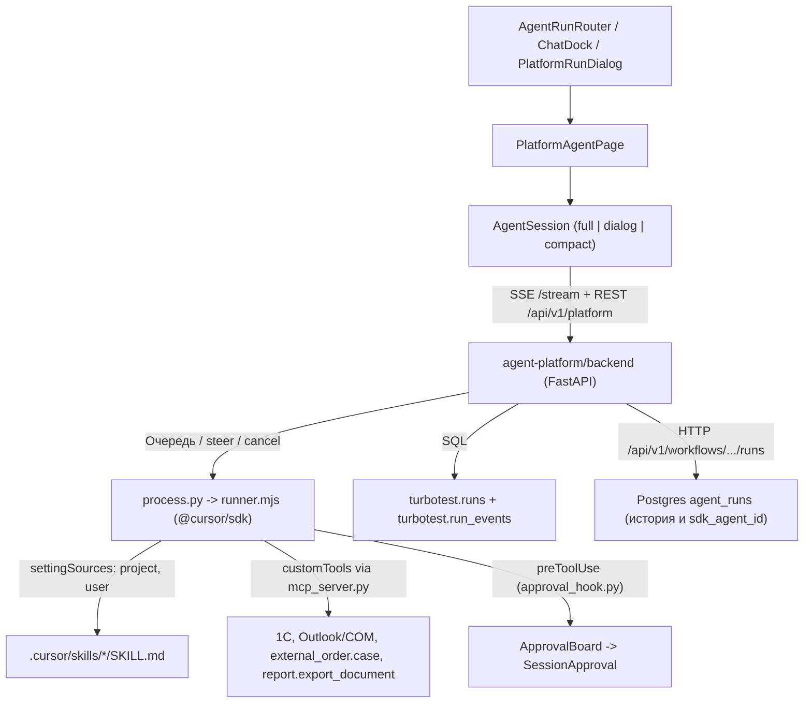

# Единый чат и Cursor-harness (`AgentSession` + `agent-platform`)

Документ описывает целевую и реализованную логику работы единого чата с ИИ-агентами в Orch_mx (`orchestrator/orchestrator/desktop-electron` + `orchestrator/orchestrator/agent-platform`). Предназначен для разработчиков и моделей, чтобы не плодить дублирующие чаты и не ломать обвязку `@cursor/sdk`.

---

## 1. Общая схема и границы

Все интерактивные диалоги с ИИ (помощники внешних заказов, личный помощник «Оркестратор», агенты Конструктора, агенты TurboTester, запуски из «Сегодня» / KPI / совещаний) работают через **один** UI-компонент `AgentSession` и **один** локальный оркестратор `agent-platform/backend` поверх `@cursor/sdk`.

Отдельно от этого контура остаются:
- `MessengerPage` (`view.kind === 'chat'`) — переписка между людьми и поддержка;
- `agent_sidecar.py` — фоновые триггеры, расписания, KPI-расчёты и COM/Outlook-шлюз (личный чат `_run_personal_agent` в нём отключён).

---

## 2. Где лежат все части

### Frontend (Renderer, `orchestrator/orchestrator/desktop-electron/src/renderer/src/`)

| Компонент / модуль | Назначение |
|---|---|
| `pages/AgentRunRouter.tsx` | Единственная точка входа для `view.kind === 'agentrun'`. Определяет источник (`platform:<uuid>` или `constructor`) и всегда рендерит `PlatformAgentPage`. Старого `AgentRunPage.tsx` больше нет. |
| `agentPlatform/PlatformAgentPage.tsx` | Для прямых чатов (`chat` заказа, `personal-agent:*`, `initialMessage`) сразу открывает `AgentSession` (для заказа — в модальном портале `variant="dialog"`). Для обычных агентов Конструктора / TurboTester показывает паспорт, план и список запусков. |
| `workplace/ChatDock.tsx` | Компактная плавающая кнопка «Чат» и drawer поверх рабочего стола. Монтирует тот же `AgentSession` в `variant="compact"` для `personal-agent:{userId}`. Собственного движка чата и `mirrorRun` в нём нет. |
| `tabs/grid/PlatformRunDialog.tsx` | Модальное окно просмотра живой сессии платформы (из полосы активных агентов, совещаний, аудио). |
| `components/ActiveAgentsStrip.tsx` | Полоса активных агентов сверху. Опрашивает `agent-platform` (`/api/v1/platform/sessions`) и оставшиеся фоновые/триггерные запуски `runs.entries` (чат-сессии личного помощника и заказов из локальной полосы отфильтрованы). |
| `agentPlatform/pages/AgentSession.tsx` | Главный компонент чата: лента (`Feed`), панель подагента (`SubagentPanel`), прогресс-бар (`ProgressBar`), вкладка заказа (`OrderSidePane`), очередь сообщений, inline `ApprovalForm` / `QuestionForm`, композитор с режимом (`Agent`/`Chat`), раздельным выбором модели/effort/fast, кнопкой выбора скиллов, `@`-упоминаниями и вложениями. |
| `agentPlatform/pages/sessionHelpers.ts` | Типы `UnifiedChatTarget`, `MentionItem`, `ModelChoice`; разбор `@[...]()` упоминаний; извлечение `offers`, `questions` и живого `OrderCaseBrief` из событий `external_order.case`. |
| `agentPlatform/pages/OrderSidePane.tsx` | Правая вкладка «Вопросы» в чате заказа: сводка дела, черновики с кнопкой «Принять» (`acceptExternalFinding`) и `ServiceGapPanel` (`answerExternalGap`, `acceptExternalFindingBatch`). |
| `agentPlatform/pages/SessionTools.tsx` | Группировка чтений (`ExploreGroup`), карточки вызовов (`ToolCard`), отображение вложенных шагов подагента `task`. |
| `agentPlatform/pages/SessionApproval.tsx` | Карточка подтверждения опасных действий (`shell`, `write`, `delete`, мутирующий `mcp`): «Разрешить», «Разрешать до конца запуска», «Всегда разрешать», «Отклонить». |
| `agentPlatform/pages/SessionQuestion.tsx` | Карточка вопросов агента (`ask_user` / `ask_choice` с вариантами, таблицей, множественным выбором и свободным текстом). |
| `agentPlatform/components/MarkdownView.tsx` | Рендер Markdown + обработка навигационных маркеров `[[nav:...]]` и `[[url:...]]` в кнопки перехода по разделам Оркестратора. |
| `agentPlatform/api/client.ts` | HTTP-клиент платформы (`apiGet`, `apiPost`, `apiDelete`) и `streamSession` (SSE-подписка на `/sessions/{id}/stream` с фолбэком на опрос в `AgentSession`). |
| `agentPlatform/api/types.ts` | Контракты `PlatformSession`, `SessionEvent`, `QueuedMessage`, `ModelSpec`, `SkillSpec`, `AgentApproval`, `AgentQuestion`. |

### Backend платформы (`orchestrator/orchestrator/agent-platform/`)

| Файл | Назначение |
|---|---|
| `backend/app/api/platform.py` | REST и SSE API `/api/v1/platform/*`: сессии, `chats/open`, `chats`, `messages` (с очередью и `steer`), `queue/{id}`, `stream`, `models`, `cancel`, `questions`, `approvals`. |
| `backend/app/platform/sessions.py` | `SessionStore`: хранение сессий и очередей (`QueuedMessage`) в памяти + JSON на диске (`PLATFORM_DATA_DIR`), `hydrate_conversation` из `agent_runs`, `Condition`-оповещения для SSE (`wait_for_change`). |
| `backend/app/platform/process.py` | Запуск `runner.mjs` подпроцессом, передача `mode`, `model`, `modelParams`, материализация скиллов, перехват `cancel_turn(keep_queue=True)`, автоматический вызов следующего сообщения из очереди `_drain_queue`, синхронизация с `constructor_runs`. |
| `backend/app/platform/models.py` | Каталог моделей через `Cursor.models.list` (`models.mjs`) с кешем на 5 минут и фолбэком на `grok-4.7` / `grok-4.6`. |
| `backend/app/platform/approvals.py` | `classify` + `confirm_action` (возвращает `False` для реального HITL) + `ApprovalBoard`. Безопасные чтения и черновики `external_order.case` проходят без остановки; `shell` (не read-only), `write`, `delete` и мутирующие MCP ждут пользователя. |
| `backend/app/platform/constructor_runs.py` | Синхронизация запусков платформы с таблицей `agent_runs` основного бэкенда (`start_run`, `finish_run`, `fetch_conversation_runs`). |
| `backend/app/platform/history.py` | Фоновая запись в Postgres схему `turbotest.runs` (включая `conversation_key`, `workflow_id`, `chat_kind`), `turbotest.run_events`, `turbotest.run_files`, `turbotest.run_insights`. |
| `backend/app/skills/registry.py` и `catalog.py` | Загрузка только встроенных скиллов (`backend/app/skills/builtin/*/SKILL.md`), с полем `roles`; `materialize_skills` копирует выбранные скиллы в `.cursor/skills` рабочей папки сессии. Личные `~/.cursor/skills` в каталог чата не читаются. |
| `backend/app/api/skills.py` | `GET /api/v1/skills` и `GET /api/v1/skills/{skill_id}`. |
| `backend/app/vendors/constructor/tools/server_tools.py` и `app/tools/passports.py` | Реестр проксируемых инструментов Constructor (`external_order.case`, 1С, Outlook/EWS, `report.export_document`, `chat.send_direct`, KPI и др.). |
| `platform/configs/02-plan-instruction/` и `03-plan-instruction/` | Раннеры `runner.mjs` (`settingSources: ["project", "user"]`, `JsonlLocalAgentStore`, `mcp_server.py`, `approval_hook.py`, `models.mjs`). Обе конфигурации синхронизированы (`CONSTRUCTOR_CONFIG_ID = "02-plan-instruction"`). |

### Electron main (`orchestrator/orchestrator/desktop-electron/src/main/agentPlatform.ts`)

Поднимает `agent-platform/backend/run_platform.py` на свободном порту `127.0.0.1`, передаёт JWT пользователя (через файл `constructor-token`, не перезапуская идущие сессии при обновлении токена), `CURSOR_API_KEY` и учётку 1С COM.

---

## 3. Как работает цикл одного сообщения (Harness)

1. **Открытие чата (`POST /api/v1/platform/chats/open`):**
   - Ищет живую или сохранённую сессию по `conversation_key` (`eo:{orderId}:{role}:{stage}` для заказа, `{workflowId}:default` или `{workflowId}~{ts}` для нового треда личного помощника).
   - Если локальной сессии нет, но `workflow_id` — UUID Конструктора, подтягивает историю из Postgres `agent_runs` (`fetch_conversation_runs`), восстанавливает `sdk_agent_id` и события (`hydrate_conversation`).
   - При `send_if_empty: true` стартовый бриф карточки заказа отправляется только если в треде ещё не было ходов (`turns == 0`).

2. **Отправка сообщения во время работы (`POST /api/v1/platform/sessions/{id}/messages`):**
   - Возврата `409` больше нет.
   - Если сессия `status === "running"`, сообщение складывается в `session.queued_messages`.
   - При `delivery === "queue"` (обычный `Enter`) оно запустится автоматически сразу после окончания текущего хода (`_drain_queue`), с сохранением `sdk_agent_id`.
   - При `delivery === "steer"` (`Ctrl+Enter` или кнопка «Сейчас», либо кнопка «Сейчас» у элемента в очереди) сообщение ставится в начало очереди, вызывается `cancel_turn(session_id, keep_queue=True)`, текущий шаг отменяется без очистки очереди, а следующее сообщение сразу стартует с `resumeAgentId`.

3. **Запуск `@cursor/sdk` (`runner.mjs`):**
   - Перед стартом `process.py` материализует выбранные скиллы в `<workspace>/.cursor/skills/<id>/SKILL.md` и обновляет `.cursor/hooks.json` (`approval_hook.py`).
   - `Agent.create` / `Agent.resume` вызывается с `settingSources: ["project", "user"]`, `customTools` из `mcp_server.py` и `JsonlLocalAgentStore`.
   - Режим (`"agent"` или `"chat"`) и модель (`model` + `modelParams`) передаются на каждый ход.
   - Искусственных стопов по тексту `WORK_RESULT` или эвристикам заказа нет: модель сама завершает цикл вызовов.
   - Если `result.status === "error"`, раннер передаёт реальный код/сообщение ошибки (`result.error` или `status: ERROR` из потока), не подменяя его заглушкой.

4. **Поток событий в UI (`GET /api/v1/platform/sessions/{id}/stream`):**
   - `AgentSession` открывает SSE-поток `streamSession(sessionId, rev)`. При обрыве соединения автоматически переключается на опрос `GET /sessions/{id}?since=...`.
   - События `thinking` рендерятся сворачиваемым блоком, последовательные чтения группируются в `ExploreGroup`, шаги подагента `task` открываются в `SubagentPanel`.

5. **Подтверждения и вопросы:**
   - **HITL (`approval_hook.py` -> `approvals.py`):** перед каждым вызовом инструмента SDK запускает `preToolUse`. Чтение, `ask_user`/`ask_choice`, `external_order.case` (включая `auto_prepare`, `propose`, `plan`, `draft_1c`) разрешаются сразу; запись файлов, опасные `shell`-команды и мутирующие MCP (`side_effect="write"`/`"dangerous"` или `requires_approval=True`) ставят сессию на ожидание в `ApprovalBoard`, и в ленте появляется `ApprovalForm`.
   - **Вопросы (`ask_user` / `ask_choice`):** MCP-сервер создаёт вопрос в `QuestionBoard`, UI показывает `QuestionForm`.

6. **Панель ввода (как в Cursor):**
   - Переключатель `Agent` / `Chat`.
   - Раздельный выбор `model`, `reasoning_effort` и `fast` из `GET /api/v1/platform/models` (только `grok-4.7` и `grok-4.6`).
   - Кнопка `Скиллы` включает только встроенные скиллы Оркестратора. В чате заказа это «Заказ» текущей роли и именные скиллы этой роли (`Тех.Проверка` и `Анализ ЗПР` у КС и развития, `Протокол` у комитета, `ТКП`, `Договор` и `План заказа` у производства). Личные `~/.cursor/skills` в список не входят.
   - Прикрепление файлов и вставка изображений из буфера (`Ctrl+V`) / drag-and-drop.
   - Меню `@` (кнопка `@` или ввод `@` в тексте):
     - `@Заказ ...` — добавляет `order_id` открытого или найденного заказа в `[Контекст]`;
     - `@<файл>` — ссылается на приложенный файл;
     - `@1С` / `@Outlook` — подсказывает источник данных;
     - `@<скилл>` — добавляет `skill_id` в список материализуемых скиллов хода.

7. **Политика режима Chat (allowlist):**
   - В `chat`-режиме хук подтверждений блокирует вызовы вне безопасного списка (включая `shell`, запись/удаление файлов и опасные инструменты).
   - Разрешены чтение, поиск, общение и регламентные действия по внешнему заказу (`external_order.case` безопасных action, `report.export_document` и read/create_draft инструменты каталога).
   - `outlook.ews_create_meeting` и `onec.meeting_protocol_write` в `chat` не отклоняются сразу: они проходят через карточку подтверждения.
   - Видимый ответ заканчивается маркером `[[turn-done]]` (если писать нечего — строка «Готово.» и маркер). Раннер вырезает маркер из ленты и завершает ход, не дожидаясь зависшего `dispose`. Если SDK уже вернул `finished` без маркера, ход тоже завершается.

---

## 4. Что важно не сломать при дальнейших доработках

- Не возвращать роутинг чатов обратно на удалённый `AgentRunPage` и не создавать второй обработчик `window.agent` для чата.
- Не возвращать `return True` в `confirm_action` (`approvals.py`), иначе отключатся подтверждения пользователя.
- При добавлении нового серверного инструмента Constructor добавлять его одновременно в `app/vendors/constructor/tools/server_tools.py` и паспорт в `app/tools/passports.py`, иначе `mcp_server.py` его не увидит.
- Поддерживать синхронность `02-plan-instruction` и `03-plan-instruction` (или оставить в `CONSTRUCTOR_CONFIG_ID` одну папку), так как платформа запускает именно `02-plan-instruction`.

---

## 5. Проверка после изменений

- `py -3.12 -m pytest tests/test_unified_harness.py -v` (в `orchestrator/orchestrator/agent-platform/backend`).
- `npx tsc --noEmit -p tsconfig.node.json` и `npm run build` (в `orchestrator/orchestrator/desktop-electron`).
